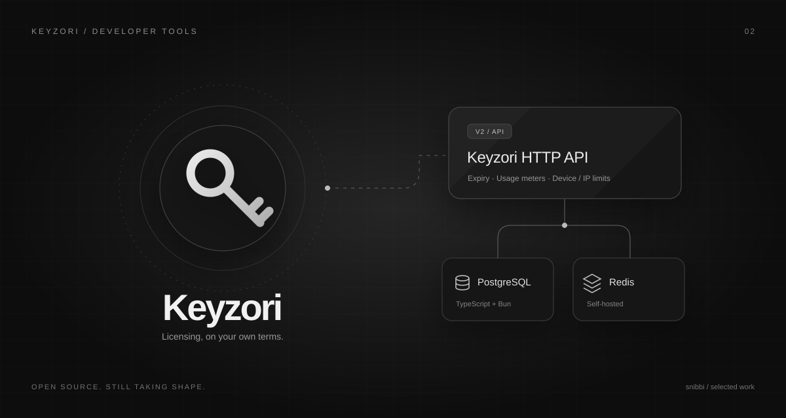

## Formatted & useful

Regular text, **strong emphasis**, *emphasis*, ~~strikethrough~~, and `inline code`
should sit comfortably together. This is a [normal link](https://example.com),
and this is a [jump to the table](#tables).

### A smaller heading

Paragraphs have room to breathe, and heading levels keep their hierarchy.
An automatic link works too: https://example.com/docs.

## Lists and quotes

1. First ordered item
2. Second ordered item
   - A nested bullet
   - Another nested bullet

- [x] Finished item
- [ ] Open item

> A blockquote can contain **formatting**.
>
> It can also contain a second paragraph.

## Code blocks

```ts
const message = "<script>This is code, not HTML.</script>";
const describe = (name: string) => `Hello, ${name}!`;

console.log(describe("reader"));
console.log("A deliberately long line to check that code scrolls inside its own container instead of making the entire page wider than the screen.");
```

An indented code block:

    bun run dev

## Tables

| Feature | Alignment | Notes |
| :--- | :---: | ---: |
| Headings | Centered | 6 levels |
| Fenced code | Centered | Preserves whitespace |
| Wide tables | Centered | Scrolls within the article |

---

## An image



The image should fit the reading column and have meaningful alternative text.
